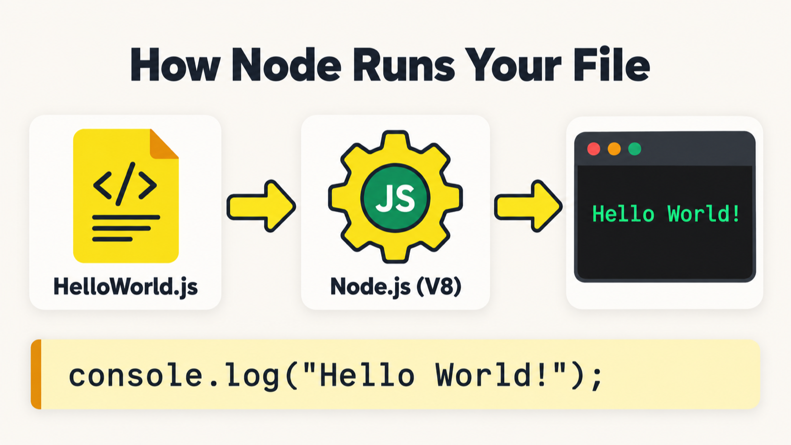
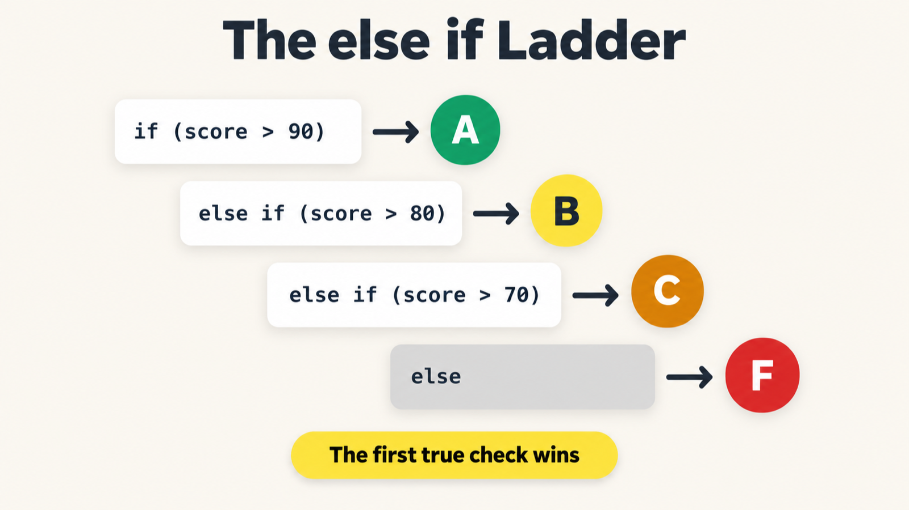
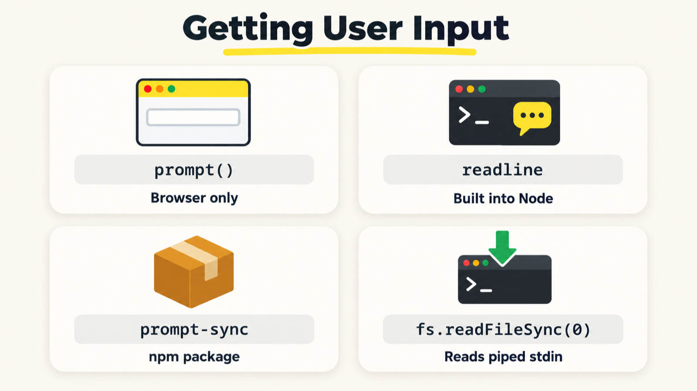
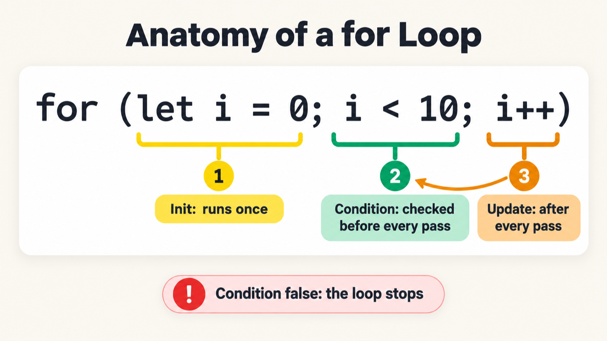

# Learn JavaScript, TypeScript & Playwright (4x)


  


A chapter-by-chapter learning repo for testers moving into JavaScript, TypeScript, and Playwright automation. Every chapter is a folder, and every lesson is a small file you can run on its own.

## Table of Contents

- [Roadmap](#roadmap)
- [Chapter Summary](#chapter-summary)
- [Project Structure](#project-structure)
- [Getting Started](#getting-started)
- [Chapter 00: Prompt Engineering](#chapter-00-prompt-engineering)
- [Chapter 01: JavaScript Basics](#chapter-01-javascript-basics)
- [Chapter 02: Keywords and Identifiers](#chapter-02-keywords-and-identifiers)
- [Chapter 03: Literals](#chapter-03-literals)
- [Chapter 04: Operators](#chapter-04-operators)
- [Chapter 05: Increment, Decrement, and Nullish Operators](#chapter-05-increment-decrement-and-nullish-operators)
- [Chapter 06: If-Else Conditions](#chapter-06-if-else-conditions)
- [Chapter 07: Switch Statement](#chapter-07-switch-statement)
- [Chapter 08: User Input](#chapter-08-user-input)
- [Chapter 09: For Loops](#chapter-09-for-loops)
- [Chapter 10: While Loops](#chapter-10-while-loops)
- [Chapter 11: Do-While Loops](#chapter-11-do-while-loops)
- [Practice Tasks](#practice-tasks)
- [Coming Up](#coming-up)

## Roadmap

1. Prompt Engineering for QA
2. JavaScript fundamentals
3. TypeScript
4. Playwright automation

## Chapter Summary

| # | Chapter | Folder | Status | What you learn |
|---|---|---|---|---|
| 00 | Prompt Engineering | `00_Chapter_Prompt_Eng/` | ✅ Done | RICE-POT prompts, anti-hallucination rules, and the Selenium framework a prompt generated |
| 01 | JavaScript Basics | `01_Chapter_JS_Basics/` | ✅ Done | Running a file with Node.js, `console.log`, and arithmetic expressions |
| 02 | Keywords and Identifiers | `02_Chapter_JS_Keywords_Identifiers/` | ✅ Done | How the JavaScript engine runs code, `var`/`let`/`const`, identifier rules, naming conventions, comments, and deep-dive research |
| 03 | Literals | `03_Chapter_JS_Literals/` | 🟡 In progress | Primitive and object literals, `null` vs `undefined`, number formats, `BigInt`, `Infinity`, and `NaN` |
| 04 | Operators | `04_Chapter_JS_Operators/` | 🟡 In progress | Assignment, arithmetic, comparison, logical, string, ternary, and `typeof` operators |
| 05 | Increment, Decrement, and Nullish Operators | `05_Chapter_JS_inrdcr_Operators/` | 🟡 In progress | Prefix and postfix increment/decrement, mixed expressions, and nullish coalescing (`??`) |
| 06 | If-Else Conditions | `06_Chapter_If-Else_Conditions/` | 🟡 In progress | `if`, `else`, nested conditions, ternary expressions, and `else if` ladders |
| 07 | Switch Statement | `07_Chapter_Switch_Statement/` | 🟡 In progress | `switch`, `case`, `break`, grouped cases, and API status code handling |
| 08 | User Input | `08_Chapter_UserInput/` | 🟡 In progress | Command line arguments, readline, `prompt-sync`, and file input |
| 09 | For Loops | `09_Chapter_Loops/` | 🟡 In progress | `for` loop structure, iteration, and practice questions |
| 10 | While Loops | `10_Chapter_Loops_While/` | 🟡 In progress | `while` loop structure, condition checks, and practice questions |
| 11 | Do-While Loops | `11_Chapter_DoWhile/` | 🟡 In progress | `do...while`, running a loop body before checking its condition, and nested loops |

## Project Structure

```text
JS-TS_Learning_Playwright4X/
├── README.md
├── package.json                          # Project metadata and prompt-sync dependency
├── package-lock.json                     # Locked npm dependency versions
├── .gitignore                             # Excludes installed dependencies
├── 00_Chapter_Prompt_Eng/                 # Prompt Engineering chapter folder
├── 01_Chapter_JS_Basics/
│   ├── 01_helloworld.js                   # First program: console.log
│   └── 02_arithmaticoperation.js          # Basic arithmetic operators
├── 02_Chapter_JS_Keywords_Identifiers/
│   ├── 03_js_engine.js                    # JavaScript engine example
│   ├── 04_js_letengine.js                 # A minimal let declaration
│   ├── 05_kw_ind.js                       # Keywords and identifiers: var, let, const
│   ├── 06_kw_ind_rules.js                 # Identifier rules
│   ├── 07_ind_rules2.js                   # Naming conventions
│   ├── 08_comments.js                     # JavaScript comment forms
│   ├── 09_interviewQuestions.js           # Identifier interview questions
│   └── 10_research_keyword_identifier.xlsx # Comprehensive keyword & identifier research
├── 03_Chapter_JS_Literals/
│   ├── 11_literal.js                      # Literal examples and types
│   ├── 12_differentliterals.js            # Common JavaScript literal kinds
│   ├── 13_null_undefined.js               # null and undefined
│   ├── 14_null.js                         # null value example
│   ├── 15_literalexample.js               # Literal declarations
│   ├── 16_numberliteral.js                # Number literal formats
│   ├── 17_numberliteralex.js              # Number, BigInt, and special values
│   ├── 18_Specials.js                     # Special numeric values
│   └── 19_undefined.js                    # undefined value example
├── 04_Chapter_JS_Operators/
    ├── 20_arch.js                         # Operator and operand introduction
    ├── 21_assignment-op.js                # Assignment operators
    ├── 22_arithmatic-op.js                # Arithmetic operators
    ├── 23_comparison-op.js                # Comparison operators
    ├── 24_logical-op.js                   # Logical operators
    ├── 25_confusing_comparsion.js         # Loose and strict equality examples
    ├── 26_questions.js                    # Operator practice questions
    ├── 27_string-op.js                    # String concatenation
    ├── 28_ternary-op.js                   # Ternary operator basics
    ├── 29_ternary-op_use.js               # Ternary operator examples
    ├── 30_ternary-op_iq.js                # Ternary interview exercise
    ├── 31_ternary-op_iq1.js               # Ternary interview exercise
    ├── 32_ternary-op_templiteral.js       # Ternary operators and template literals
    ├── 33_ternary-op_bool.js              # Boolean ternary example
    ├── 34_ternary-op_nested.js            # Nested ternary examples
    ├── 35_ternary-op_nestediq.js          # Nested ternary interview exercise
    ├── 36_ternary-op_nested3.js           # Nested ternary example
    └── 37_typeof.js                       # typeof operator
├── 05_Chapter_JS_inrdcr_Operators/
│   ├── 38_preincr-op.js                   # Prefix increment
│   ├── 39_postincr-opjs                   # Postfix increment
│   ├── 40_preincrarithmatic-op.js         # Prefix increment in arithmetic
│   ├── 41_prepostincrarith-op.js          # Prefix and postfix arithmetic
│   ├── 42_prepostincrement.js             # Prefix and postfix comparison
│   ├── 43_predecre-op.js                  # Prefix decrement
│   ├── 44_postdecre-op.js                 # Postfix decrement
│   └── 45_nullish-op.js                   # Nullish coalescing operator
├── 06_Chapter_If-Else_Conditions/
│   ├── 46_if-else_statement.js             # Basic if-else statement
│   ├── 47_nested_if-else_statement         # Nested if-else condition
│   ├── 48_ternary_if-else_statements       # Ternary comparison with if-else
│   └── 49_multiple_if-else.js              # Multiple else-if conditions ladder
├── 07_Chapter_Switch_Statement/
│   ├── 50_swithch_case.js                  # Basic switch-case
│   ├── 51_iq_swithch.js                    # Switch interview exercise
│   ├── 52_iq1_switch.js                    # Switch expression exercise
│   ├── 53_api_swithch.js                   # API status code handling
│   ├── 54_swithc_group.js                  # Grouped switch cases
│   ├── 55_switch_iq.js                     # Strict matching in switch
│   ├── 56_switch_iq1                       # Switch logic quiz
│   ├── 57_switch_iq2.js                    # Default placement in switch
│   └── 58_swith_iq3.js                     # Switch interview questions
├── 08_Chapter_UserInput/
│   ├── 59_userinput.js                     # Process arguments
│   ├── 60_node_userinput.js                # Node.js readline input
│   ├── 61_prompt_sync.js                   # Synchronous prompt input
│   └── 62_fs_readfile.js                   # File input with fs
├── 09_Chapter_Loops/
│   ├── 63_for_loop.js                      # Basic for loop
│   ├── 64_for_loops.js                     # For loop example
│   ├── 65_forloop_iq1.js                   # For loop exercise
│   ├── 66_forloop_iq2.js                   # For loop exercise
│   ├── 67_forloop_iq3.js                   # For loop exercise
│   └── 68_forloop_iq4.js                   # For loop exercise
├── 10_Chapter_Loops_While/
│   ├── 69_while_loop.js                    # Basic while loop
│   ├── 70_whileloop_iq1.js                 # While loop exercise
│   ├── 71_whileloop_iq2.js                 # While loop exercise
│   └── 72_whileloop_iq3.js                 # While loop exercise
├── 11_Chapter_DoWhile/
│   ├── 73_dowhile.js                       # Basic do-while loop
│   ├── 74_dowhile_iq1.js                   # Do-while exercise
│   ├── 75_nestedfor.js                     # Nested for loops
│   └── 76_forloop_iq2.js                   # Loop exercise
├── Assets-Images/
│   ├── banner.png
│   ├── ch00-rice-pot.png
│   ├── ch01-node-runs-file.png
│   ├── ch02-declaration-anatomy.png
│   ├── ch03-null-vs-undefined.png
│   ├── ch04-loose-vs-strict.png
│   ├── ch04-ternary.png
│   ├── ch05-pre-vs-post.png
│   ├── ch06-else-if-ladder.png
│   ├── ch07-switch-break.png
│   ├── ch08-user-input.png
│   ├── ch09-for-loop-anatomy.png
│   ├── ch10-while-loop.png
│   └── ch11-while-vs-do-while.png
└── Tasks/
    ├── hello_14-10.js                     # Hello World exercise
    ├── inputfromusers_14-10.js             # Read text from standard input
    ├── multiple-tables_14-10.js            # Multiplication table exercise
    ├── fizz_buzz_14-10.js                  # FizzBuzz exercise
    ├── grade_calculator_14-10.js           # Grade calculator using switch
    ├── operators_tasks.js                  # Operator practice tasks
    └── triangle_classifier_16-10.js        # Classify a triangle from its side lengths
```

## Getting Started

Install Node.js 18 or newer, then install the dependency used by the `prompt-sync` lesson:

```sh
git clone https://github.com/praveenm247/JS-TS_Learning_Playwright4X.git
cd JS-TS_Learning_Playwright4X
npm install
node --version
node 01_Chapter_JS_Basics/01_helloworld.js
```

Run any lesson with `node <chapter-folder>/<file>.js` from the repository root.
The `08_Chapter_UserInput/61_prompt_sync.js` lesson uses the installed `prompt-sync` package.

## Chapter 00: Prompt Engineering

### 00: RICE-POT Prompt Engineering

**Concept:** RICE-POT is a seven-part prompt template: Role, Instructions, Context, Example, Parameters, Output, and Tone. It helps produce useful test artifacts instead of toy snippets.

**Why:** A one-line request such as “write Selenium code” leaves the model to guess versions, APIs, and what a complete result should contain. RICE-POT makes those requirements explicit and adds anti-hallucination constraints.

**Q&A: Why use this?**

- **When do I reach for it?** When asking an AI to draft a framework, test plan, or test cases. A reusable QA template can cover each task type.
- **What does it replace?** Ad-hoc prompts that omit the stack, version requirements, and expected output.
- **What is the gotcha?** A structured prompt can still produce invented APIs. Pin library versions, state what not to use, and review generated code before relying on it.

An example anti-hallucination block for a Selenium prompt:

```text
Role: Senior SDET Automation Architect.
Task: Generate a test automation script for [Application/Workflow].

Constraints:
1. Use Java 17+, Selenium 4.x, and TestNG 7.x.
2. Use java.time.Duration for timeouts.
3. Use ChromeOptions or FirefoxOptions; do not use DesiredCapabilities.
4. Use WebDriverWait(driver, Duration.ofSeconds(x)).
5. Use standard Selenium 4 APIs. Do not invent WebDriver or WebElement methods.
6. Include valid, complete imports.
```

The supplied learning outline describes a generated Selenium framework in this chapter. The `00_Chapter_Prompt_Eng/` folder is currently empty in this checkout.


## Chapter 01: JavaScript Basics



### 01: Hello World

**Concept:** `console.log()` prints a value. Run a `.js` file with Node.js and the output appears in your terminal.

**Why:** Before variables, functions, or Playwright, you need a reliable way to see what your code is doing.

**Q&A: Why use this?**

- **When do I reach for it?** To inspect a value while learning or debugging. In Playwright, it is a quick debugging tool alongside the browser tools.
- **What does it replace?** The basic role of Java's `System.out.println` or Python's `print`; JavaScript needs no class or main method for this example.
- **What is the gotcha?** Output goes to the terminal under Node.js, but browser-side JavaScript logs to the browser's developer console.

```js
// 01_Chapter_JS_Basics/01_helloworld.js
console.log("Hello, World!");
```

```text
$ node 01_Chapter_JS_Basics/01_helloworld.js
Hello, World!
```

### 02: Math with Numbers

**Concept:** JavaScript evaluates an arithmetic expression before passing its result to `console.log()`.

**Why:** Tests calculate expected values such as totals and counts, so it helps to understand how JavaScript evaluates arithmetic.

**Q&A: Why use this?**

- **When do I reach for it?** To calculate an expected value, such as `price * quantity`, from test data.
- **What does it replace?** Manually calculating values and copying fixed answers into test data.
- **What is the gotcha?** `+` also concatenates strings: `"1" + 2` produces `"12"`. JavaScript numbers use floating point, so `0.1 + 0.2` is not represented exactly as `0.3`.

```js
// 01_Chapter_JS_Basics/02_arithmaticoperation.js
console.log("Addition: " + (5 + 3));
console.log("Subtraction: " + (5 - 3));
console.log("Multiplication: " + (5 * 3));
console.log("Division: " + (5 / 3));
console.log("Modulus: " + (5 % 3));
```

| Operator | Meaning | Example | Result |
|---|---|---:|---:|
| `+` | Add (or concatenate strings) | `1 + 2` | `3` |
| `-` | Subtract | `5 - 2` | `3` |
| `*` | Multiply | `2 * 2` | `4` |
| `/` | Divide | `7 / 2` | `3.5` |
| `%` | Remainder | `7 % 2` | `1` |
| `**` | Exponentiation | `2 ** 3` | `8` |

## Chapter 02: Keywords and Identifiers


### 03: The JavaScript Engine

**Concept:** Node.js uses the V8 JavaScript engine. V8 parses and compiles JavaScript, runs it, and can optimize frequently executed code while the program is running. This is just-in-time (JIT) compilation.

**Why:** Understanding that the engine parses a file before executing it helps explain why a syntax error can prevent earlier lines from running. Frequently executed code may also be optimized at runtime.

**Q&A: Why learn this?**

- **When do I reach for it?** When debugging a syntax error that prevents the file from starting.
- **What does it replace?** The oversimplified idea that JavaScript is only interpreted. Modern engines combine compilation, interpretation, and runtime optimization.
- **What is the gotcha?** The hot-code loop in `03_js_engine.js` is commented out because repeated logging can flood the terminal. Function declarations can be called before their position in source due to hoisting.

```js
// 02_Chapter_JS_Keywords_Identifiers/03_js_engine.js
let a = 10;
console.log(a);
```

```text
$ node 02_Chapter_JS_Keywords_Identifiers/03_js_engine.js
10
```

### 04: A Minimal `let` Program

`04_js_letengine.js` contains a minimal program with a `let` declaration. It prints nothing, but Node.js still parses and executes the file.

### 05: Keywords vs Identifiers: `var`, `let`, `const`

**Concept:** A keyword is reserved by the language; an identifier is a name you choose. In `let l = 10`, `let` is the keyword, `l` is the identifier, and `10` is the numeric value.

**Why:** Variables in tests—URLs, timeouts, expected values, and configuration—begin with a declaration. Choosing the declaration keyword is a basic JavaScript decision.

**Q&A: Why use this?**

- **When do I reach for it?** Use `let` for a binding that will be reassigned, `const` when it will not, and recognize `var` when reading older code.
- **What does it replace?** Before ES2015, `var` was the usual variable declaration. `let` and `const` are block-scoped; `var` is function-scoped.
- **What is the gotcha?** `const` prevents reassignment of the binding, not mutation of an object or array it refers to. For example, `const items = []; items.push(1)` is valid.

```js
// 02_Chapter_JS_Keywords_Identifiers/05_kw_ind.js
var v = 10;   // keyword: var,   identifier: v
let l = 10;   // keyword: let,   identifier: l
const c = 10; // keyword: const, identifier: c
```

| | `var` | `let` | `const` |
|---|---|---|---|
| Scope | Function | Block | Block |
| Redeclare in the same scope | Allowed | SyntaxError | SyntaxError |
| Reassign binding | Allowed | Allowed | Not allowed |

### 06: Identifier Rules

**Concept:** An identifier can start with a letter, `_`, or `$`. Later characters can also include digits. Identifiers cannot contain spaces or hyphens, and they cannot use reserved words. Names are case-sensitive.

**Why:** An invalid identifier causes a syntax error, which can prevent the whole file from running.

**Q&A: Why use this?**

- **When do I reach for it?** Whenever you name a variable, function, or class: check the first character, the remaining characters, and whether the name is reserved.
- **What does it replace?** Nothing; these are the rules the parser applies to names. A standalone `$` or `_` is valid.
- **What is the gotcha?** `Name` and `name` are different identifiers. A parser error may point near the invalid name rather than describe the naming rule.

```js
// 02_Chapter_JS_Keywords_Identifiers/06_kw_ind_rules.js (excerpt)
var $ = 10;
var _a = 23;
var ab123 = 23;
var Name = "one";
var name = "two";

// var 45 = 34;       // Invalid: cannot start with a number
// var pramod-dutta;  // Invalid: hyphens are not allowed
```

### 07: Naming Conventions

**Concept:** Naming conventions are team agreements. JavaScript commonly uses camelCase for variables and functions, PascalCase for classes, and SCREAMING_SNAKE_CASE for fixed configuration values.

**Why:** Consistent casing helps readers recognize the role of a name quickly. The engine accepts many styles, so conventions are for people and tools.

**Q&A: Why use this?**

- **When do I reach for it?** Use camelCase for variables and functions, PascalCase for classes and page objects, and SCREAMING_SNAKE_CASE for constants and configuration where the team uses that convention.
- **What does it replace?** Older Hungarian notation such as `strName` or `bActive`, which encodes type-like information in the name.
- **What is the gotcha?** Naming conventions are not enforced by JavaScript itself. A linter or code review can help apply them consistently.

| Convention | Example | Common use |
|---|---|---|
| camelCase | `totalPrice` | Variables and functions |
| PascalCase | `ShoppingCart` | Classes and constructors |
| SCREAMING_SNAKE_CASE | `API_KEY` | Fixed configuration values |
| snake_case | `total_price` | Uncommon in JavaScript; common in other languages |
| Hungarian notation | `bActive` | Legacy code |

### 08: Comments

**Concept:** Comments are ignored by the JavaScript engine. `//` comments to the end of a line, `/* ... */` spans lines, and `/** ... */` is commonly used for JSDoc documentation.

**Why:** Comments can explain intent, and temporarily commenting out a line can help during debugging.

**Q&A: Why use this?**

- **When do I reach for it?** To explain why code exists or document functions with JSDoc. In VS Code, `Ctrl + /` toggles a line comment on Windows and Linux.
- **What does it replace?** Nothing; JavaScript uses familiar line and block comment forms. JSDoc is commonly used for editor hints and generated documentation.
- **What is the gotcha?** Block comments do not nest. The first `*/` closes the comment.

```js
// 02_Chapter_JS_Keywords_Identifiers/08_comments.js
// Single-line comment

/* Multi-line comment */

/** Documentation comment (JSDoc style) */
```

### 09: Interview Questions on Identifiers

**Concept:** The interview exercise collects valid and invalid identifier examples, including case sensitivity and less common names.

**Why:** Practicing examples helps turn the identifier rules into a quick check when reading or writing code.

**Q&A: Why use this?**

- **When do I reach for it?** To review identifier rules before an interview or when checking whether a name is valid.
- **What does it replace?** Memorizing a handful of examples; apply the general rule to each name instead.
- **What is the gotcha?** Built-in global names are not necessarily reserved words. For example, `Function` is a built-in name that can be shadowed, while reserved words such as `class` cannot be used as ordinary variable names.

```js
// 02_Chapter_JS_Keywords_Identifiers/09_interviewQuestions.js (excerpt)
let validName = "starts with a letter";
let _private = "starts with underscore";
let $jquery = "starts with dollar sign";
let a1_b2 = "letters, digits, and underscore";

// let 1stPlace = "invalid"; // Cannot start with a digit
// let my-name = "invalid";  // Hyphens are not allowed
```

## Chapter 03: Literals

The lessons in `03_Chapter_JS_Literals/` introduce JavaScript literal values, including strings, booleans, arrays, objects, `null`, and `undefined`. Number examples cover decimal, binary, octal, hexadecimal, exponential notation, numeric separators, `BigInt`, `Infinity`, and `NaN`.


## Chapter 04: Operators

The lessons in `04_Chapter_JS_Operators/` introduce assignment, arithmetic, comparison, logical, string, and ternary operators, plus the `typeof` operator. The examples compare loose (`==`) and strict (`===`) equality.


## Chapter 05: Increment, Decrement, and Nullish Operators

The lessons in `05_Chapter_JS_inrdcr_Operators/` cover prefix and postfix increment/decrement, their results inside expressions, and nullish coalescing with `??`.


## Chapter 06: If-Else Conditions

The lessons in `06_Chapter_If-Else_Conditions/` introduce branching with `if`, `else`, nested conditions, ternary expressions, and `else if` ladders.



## Chapter 07: Switch Statement

The lessons in `07_Chapter_Switch_Statement/` cover `switch` and `case`, `break`, grouped cases, strict matching, and routing API status codes.


## Chapter 08: User Input

The lessons in `08_Chapter_UserInput/` cover command line arguments, Node.js `readline`, synchronous input with `prompt-sync`, and reading files with `fs`.



## Chapter 09: For Loops

The lessons in `09_Chapter_Loops/` introduce the `for` loop's initialization, condition, and update expressions, with examples and practice questions.



## Chapter 10: While Loops

The lessons in `10_Chapter_Loops_While/` cover `while` loops, where the condition is checked before each iteration, with practice questions.


## Chapter 11: Do-While Loops

The lessons in `11_Chapter_DoWhile/` show `do...while` loops, which execute the loop body once before checking the condition, plus nested loop exercises.


## Practice Tasks

The `Tasks/` folder contains short exercises for output, user input, multiplication tables, FizzBuzz, grade calculation, operators, and triangle classification. Run a task from the repository root with `node Tasks/<file>.js`. The multiplication table and triangle tasks use the installed `prompt-sync` dependency.

## Coming Up

Continue with JavaScript fundamentals, then move on to TypeScript and Playwright automation.
